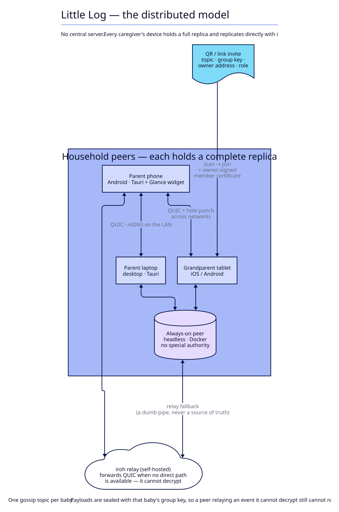
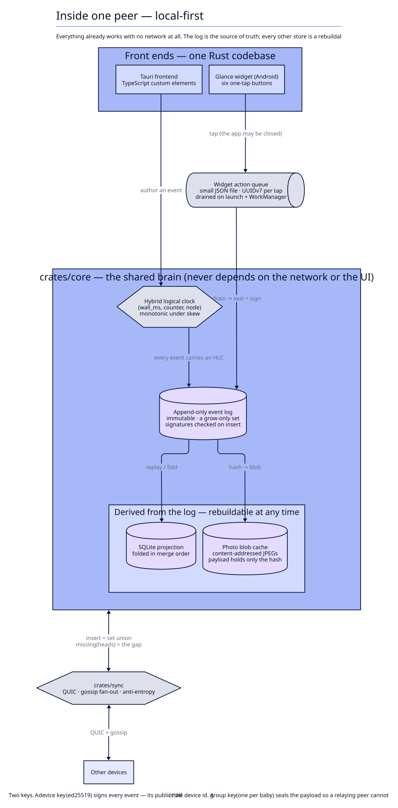
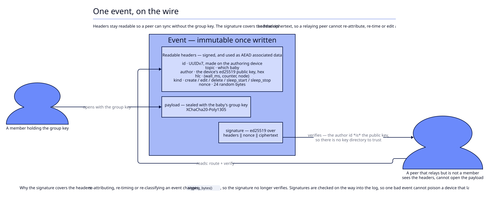
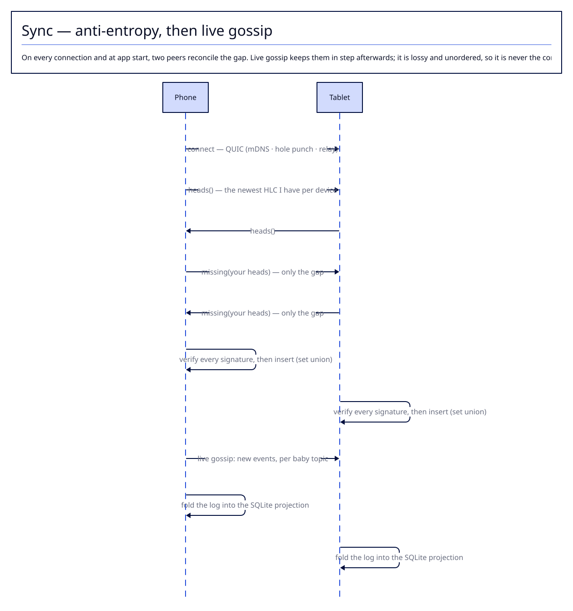
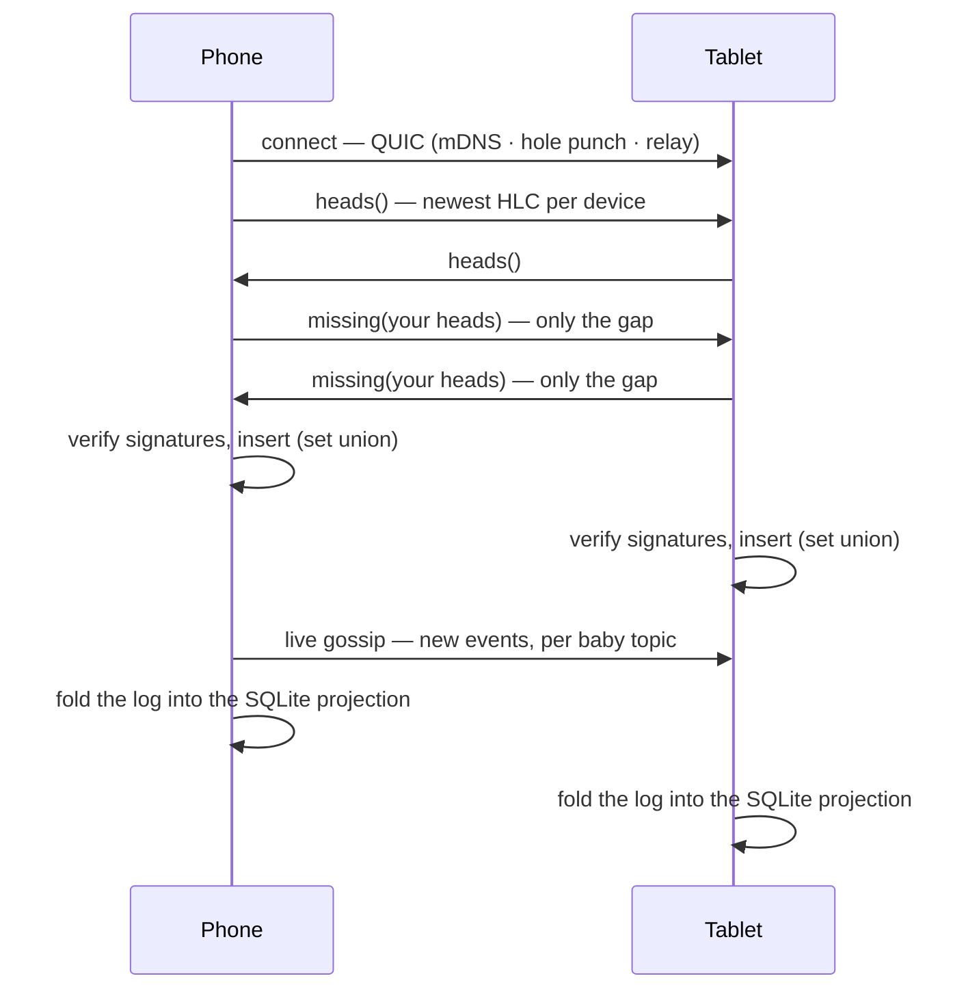
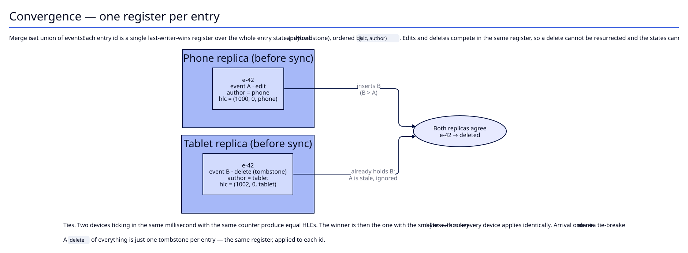
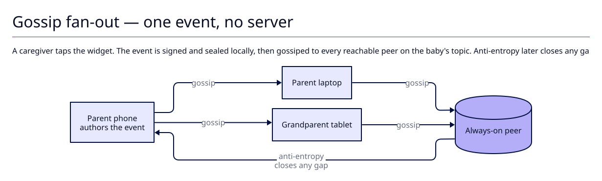

# Architecture diagrams

Illustrations of the distributed model described in [`PLAN.md`](../../PLAN.md).

They are drawn with **[D2](https://d2lang.com)** (MIT —
[terrastruct/d2](https://github.com/terrastruct/d2)) from the `.d2` sources in
this directory. The rendered SVG is committed, so you can read these docs without
installing anything; you only need D2 to *change* a diagram.

> D2 was chosen because it is open source, single-binary, and produces real
> vector architecture diagrams (shapes, containers, icons, themes, and animated
> output) from a small text file that reviews well in a pull request.

## The distributed model, in one paragraph

There is no central server and no account system. Every caregiver's device holds
a **complete replica** of one baby's log and works fully offline. Devices
replicate **directly with each other** over QUIC: live gossip for new events, and
**anti-entropy** on every connection to close any gap. Merge is **set union** of
immutable, signed, encrypted events, so re-sending one is harmless. Where two
replicas disagree, a **last-writer-wins register per entry** ordered by
`(hlc, author)` decides — identically on every device, without any device having
to agree on wall-clock time or on arrival order. Membership and roles are
cryptographic: an invite hands over the baby's group key and the owner signs a
member certificate, so no server ever vouches for anyone.

## 1. The whole system — no central server

Every device is a peer. The always-on container is just a device that is always
reachable; the relay only forwards QUIC when a direct path is impossible.



## 2. Inside one peer — local-first

The append-only event log is the source of truth. The SQLite tables and the photo
blob cache are **projections** that can be thrown away and rebuilt. The Android
widget writes into a small queue while the app is closed; the queue is drained on
launch and by a WorkManager worker.



## 3. One event, on the wire

Headers stay readable so a peer can sync without the group key. The payload is
sealed with the baby's group key, and the signature covers the headers *and* the
ciphertext — so a device relaying an event cannot re-attribute, re-time or edit it.



## 4. Sync — anti-entropy, then live gossip

On every connection and at app start, two peers exchange the newest HLC they have
per device, then each sends only what the other is missing. Gossip keeps them in
step afterwards, but gossip is lossy and unordered, so it is never the
correctness guarantee.



The same handshake as Mermaid, which renders inline anywhere GitHub does and
needs no build step:



There is also an animated rendering, `04-sync-animated.svg`, which walks through
the messages in order. GitHub will not animate an SVG inline — open the file
directly to see it.

## 5. Convergence — one register per entry

Edits and deletes compete in the same last-writer-wins register, ordered by
`(hlc, author)`. A late edit therefore cannot resurrect a deleted entry, and two
devices can never oscillate. Equal HLCs are broken by comparing the author key
bytes — a rule every device applies the same way, so arrival order never matters.



## 6. Gossip fan-out — animated

A tap on the widget becomes a signed, sealed event that is gossiped to every
reachable peer on the baby's topic; anti-entropy closes any gap afterwards.



Open `06-gossip-animated.svg` directly to watch the event propagate.

## What already exists in the code

The model above is the target in `PLAN.md`. As of this writing, `crates/core`
implements the foundation; the networking layer is the phase-2 spike.

| Element in the diagrams | Where | Status |
|---|---|---|
| Hybrid logical clock | `crates/core/src/clock.rs` | done |
| Event envelope: seal / open / verify | `crates/core/src/event.rs` | done |
| Device key (ed25519) + group key (per baby) | `crates/core/src/crypto.rs` | done |
| Append-only log, set union, `heads()` / `missing()` | `crates/core/src/log.rs` | done |
| Store: `events` + `device_keys` tables | `crates/core/src/repo.rs` (schema v3) | in progress |
| Roles matrix (`permissions::can`) | `crates/core/src/permissions.rs` | done, applied server-side today |
| Widget action queue | `crates/core/src/pending.rs` | done |
| `crates/sync` — QUIC, gossip fan-out, anti-entropy, discovery | — | planned (phase 2 spike) |
| Always-on peer + iroh relay | `deploy/` | planned (phase 5) |
| Tauri app, Glance widget | `app/` | exists |
| Frontend custom elements | `web/` | exists |

## Regenerating the diagrams

The D2 toolchain is kept project-local and gitignored, so nothing is installed
globally.

```bash
docs/architecture/render.sh            # render every *.d2 -> *.svg
docs/architecture/render.sh --png      # also emit *.png (handy for slides)
```

The first run downloads the pinned D2 release into `.tools/d2/` (about 38 MB).
Set `D2_THEME` to change the theme (default `3`); see `d2 --help` for the list.
